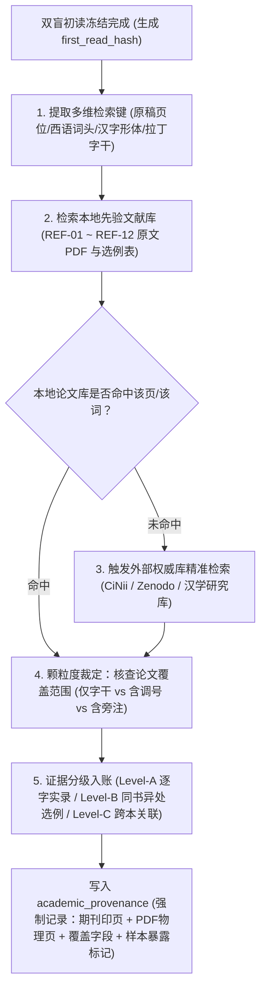
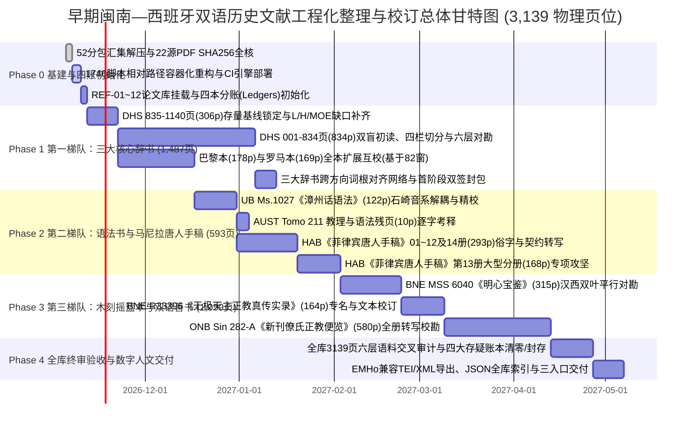

# 早期闽南—西班牙双语历史文献工程化整理与校订总体方案 (Master Engineering & Philological Plan v3.0)

> **版本信息**：v3.0（基于 Handoff v2.0 底本与 `D:\Codex\2.闽南文史工作区\闽南文献迁移\literature` 实盘元数据深度核定）  
> **适用范围**：明末清初多明我会及马尼拉华人（Sangleys）22 份双语历史文献原件（共 3,139 物理页位、9 条书组执行线）  
> **核心定位**：兼具**工业级工程可落地性**（标准化流水线、双盲哈希锁、自动化 CI 校验、四账分离）与**历史语言学最高学术严谨度**（六层标音物理隔离、古文书学笔迹拆解、先验论文分级证据链）的开箱即用施工总纲。

---

## 一、 全局物理资产盘点与基线总账 (Physical Workspace & Baseline Inventory)

### 1.1 工作区磁盘架构与归档完整性
* **工作区根路径**：`D:\Codex\2.闽南文史工作区\闽南文献迁移`（工作区入口目录：[`literature/`](file:///d:/Codex/2.闽南文史工作区/闽南文献迁移/literature)）
* **物理分卷资产**：共 **52 个独立 ZIP 归档包**（压缩总体积 **13.73 GB**，解压后约 **14.34 GB**，总清单记录 **1,865 个目标文件项**，当前磁盘可用空间 **685+ GB**）：
  1. `闽南文献迁移_00_总入口与清单_v2_20261029.zip`：项目交接总入口（[`00_从这里开始.md`](file:///d:/Codex/2.闽南文史工作区/闽南文献迁移/literature/00_从这里开始.md)、[`01_接手状态与施工顺序.md`](file:///d:/Codex/2.闽南文史工作区/闽南文献迁移/literature/01_接手状态与施工顺序.md)、[`02_缺件与边界.md`](file:///d:/Codex/2.闽南文史工作区/闽南文献迁移/literature/02_缺件与边界.md)）、22 源实际路径映射（[`source22_actual_mapping.json`](file:///d:/Codex/2.闽南文史工作区/闽南文献迁移/literature/source22_actual_mapping.json)）、归档完整性校验（[`archive_integrity.json`](file:///d:/Codex/2.闽南文史工作区/闽南文献迁移/literature/archive_integrity.json)）及原始 Slack 历史记录。
  2. `闽南文献迁移_重复小文件路径补齐_20261029.zip`：12 个跨目录小文本与脚本快照补丁包。
  3. `闽南文献迁移_资产_01_20261029.zip` ~ `闽南文献迁移_资产_50_20261029.zip`：50 个连续独立分包（编号 01~50 无缺失，支持单包独立解压汇集至 `literature/`）。
* **代码与技能资产储备**：[`skills_and_code_index.json`](file:///d:/Codex/2.闽南文史工作区/闽南文献迁移/literature/skills_and_code_index.json) 索引收录历版归档内 **7,625 条成员位置记录**（去重后对应 **1,746 个独立项目脚本与技能文件**，涵盖 `build_batch_v1.py`、`extract_native_visual_tiles_v1.py`、`audit_body_coverage_v1.py`、`save_aust_v3.py` 及 `transcribe-historical-minnan` 技能规约）。

### 1.2 22 份历史文献原件全量清单与 SHA-256 锚定总表
全项目固定范围为 **22 份来源 PDF、3,139 个物理页位、9 条书组执行线**。经核对 [`source22_actual_mapping.json`](file:///d:/Codex/2.闽南文史工作区/闽南文献迁移/literature/source22_actual_mapping.json)，22 份原件 PDF 的 SHA-256 与 2026-10-16 来源总账 **100% 吻合**（注：第 3 书组 HAB 14 册实盘物理页位合计为 **461 页**，全库 22 份 PDF 物理页位总和精确等于 **3,139 页**）：

| 书组线 | Source ID | 文献标准名称与馆藏号 | 归档相对路径 (`literature/` 下) | 物理页位 | 原件 SHA-256 校验和 (前 16 位) | 文献体裁与语言结构特征 |
|---|---|---|---|---:|---|---|
| **Line 1** | `01_DHS_Hispanico_Sinicum` | 《西班牙—华语辞典》(*Dictionario Hispánico Sinicum*, UST) | `history_and_sources/01_丛刊一_西班牙-华语辞典_Dictionario_Hispánico_Sinicum.pdf` | 1,140 | `a77466a1371bd9bd...` | 西汉双栏/多栏大型辞书；含西语词头、汉字、早期漳州话音写（带 T01~T07 调号）及右栏（第四栏）官话对音 |
| **Line 2** | `02_UB_Ms1027` | 《漳州话语法》(*Arte de la Lengua Chio Chiu*, UB Ms. 1027) | `original_sources/01_丛刊一底本_漳州话语法_UB_Ms1027.pdf` | 122 | `4e2c915d4807aec3...` | 拉丁/西语框架语法专著；系统阐述 17 世纪早期漳州话音系、声调、量词与句法范例 |
| **Line 3** | `03_HAB_91.2_Extrav_01` | 《菲律宾唐人手稿·册01》(HAB 91.2 Extrav 01) | `original_sources/02_丛刊二_菲律宾唐人手稿_HAB_91.2_Extrav_01.pdf` | 23 | `c81ac8022d8f79bb...` | 沃尔芬比特尔馆藏马尼拉华人手稿（书信、契约、字汇、杂钞） |
| **Line 3** | `04_HAB_91.2_Extrav_02` | 《菲律宾唐人手稿·册02》(HAB 91.2 Extrav 02) | `original_sources/02_丛刊二_菲律宾唐人手稿_HAB_91.2_Extrav_02.pdf` | 34 | `218fa51e5067c6a1...` | 同上（民间手写俗字、草书与早期白话语料密集） |
| **Line 3** | `05_HAB_91.2_Extrav_03` | 《菲律宾唐人手稿·册03》(HAB 91.2 Extrav 03) | `original_sources/02_丛刊二_菲律宾唐人手稿_HAB_91.2_Extrav_03.pdf` | 20 | `650b02b2c0c88f33...` | 同上 |
| **Line 3** | `06_HAB_91.2_Extrav_04` | 《菲律宾唐人手稿·册04》(HAB 91.2 Extrav_04) | `original_sources/02_丛刊二_菲律宾唐人手稿_HAB_91.2_Extrav_04.pdf` | 11 | `6e90bb872363f5cc...` | 同上 |
| **Line 3** | `07_HAB_91.2_Extrav_05` | 《菲律宾唐人手稿·册05》(HAB 91.2 Extrav 05) | `original_sources/02_丛刊二_菲律宾唐人手稿_HAB_91.2_Extrav_05.pdf` | 43 | `420aacaeeb59a65a...` | 同上 |
| **Line 3** | `08_HAB_91.2_Extrav_06` | 《菲律宾唐人手稿·册06》(HAB 91.2 Extrav 06) | `original_sources/02_丛刊二_菲律宾唐人手稿_HAB_91.2_Extrav_06.pdf` | 45 | `eba482ff2e4078b9...` | 同上 |
| **Line 3** | `09_HAB_91.2_Extrav_07` | 《菲律宾唐人手稿·册07》(HAB 91.2 Extrav 07) | `original_sources/02_丛刊二_菲律宾唐人手稿_HAB_91.2_Extrav_07.pdf` | 24 | `e21b78a7dfa2b629...` | 同上 |
| **Line 3** | `10_HAB_91.2_Extrav_08` | 《菲律宾唐人手稿·册08》(HAB 91.2 Extrav 08) | `original_sources/02_丛刊二_菲律宾唐人手稿_HAB_91.2_Extrav_08.pdf` | 17 | `58877641bd29f655...` | 同上 |
| **Line 3** | `11_HAB_91.2_Extrav_09` | 《菲律宾唐人手稿·册09》(HAB 91.2 Extrav 09) | `original_sources/02_丛刊二_菲律宾唐人手稿_HAB_91.2_Extrav_09.pdf` | 12 | `2fa0699619ac7be0...` | 同上 |
| **Line 3** | `12_HAB_91.2_Extrav_10` | 《菲律宾唐人手稿·册10》(HAB 91.2 Extrav 10) | `original_sources/02_丛刊二_菲律宾唐人手稿_HAB_91.2_Extrav_10.pdf` | 14 | `4e373a962a3bd202...` | 同上 |
| **Line 3** | `13_HAB_91.2_Extrav_11` | 《菲律宾唐人手稿·册11》(HAB 91.2 Extrav 11) | `original_sources/02_丛刊二_菲律宾唐人手稿_HAB_91.2_Extrav_11.pdf` | 12 | `6f4d41dff3a30dfa...` | 同上 |
| **Line 3** | `14_HAB_91.2_Extrav_12` | 《菲律宾唐人手稿·册12》(HAB 91.2 Extrav 12) | `original_sources/02_丛刊二_菲律宾唐人手稿_HAB_91.2_Extrav_12.pdf` | 28 | `eb400b127bc4c341...` | 同上 |
| **Line 3** | `15_HAB_91.2_Extrav_13` | 《菲律宾唐人手稿·册13》(HAB 91.2 Extrav 13) | `original_sources/02_丛刊二_菲律宾唐人手稿_HAB_91.2_Extrav_13.pdf` | 168 | `083384f948b0c34a...` | HAB 书组体量最大分册（168 页） |
| **Line 3** | `16_HAB_91.2_Extrav_14` | 《菲律宾唐人手稿·册14》(HAB 91.2 Extrav 14) | `original_sources/02_丛刊二_菲律宾唐人手稿_HAB_91.2_Extrav_14.pdf` | 10 | `77d32b1da0c19b0f...` | 同上（HAB 01~14 合计 **461 页**） |
| **Line 4** | `17_BNE_MSS6040_Mingxin` | 《明心宝鉴》(高母羡 Juan Cobo 译本, BNE MSS 6040) | `original_sources/03_明心宝鉴_BNE_MSS6040.pdf` | 315 | `31a6a245a76ff16e...` | 汉籍善书对译手稿（左/右叶汉文原典与西班牙文翻译平行对勘） |
| **Line 5** | `18_BNE_R33396_Shilu` | 《无极天主正教真传实录》(BNE R33396) | `original_sources/04_无极天主正教真传实录_BNE_R33396.pdf` | 164 | `fd82f3b7d64e4b12...` | 早期马尼拉木刻摇篮本汉籍；含早期天主教神学、哲学及科学音译专名 |
| **Line 6** | `19_BnF_Chinois9276_Paris` | 《华语西班牙语辞典·巴黎平行本》(BnF Chinois 9276) | `original_sources/05_华语西班牙语辞典_巴黎平行本_BnF_Chinois9276.pdf` | 178 | `8fb48ccf99054d5d...` | 汉西方向辞书抄本（与罗马本同源传抄分支，严禁互当独立语音双证） |
| **Line 7** | `20_Angelica_Ms60_DSH` | 《华语西班牙语辞典·罗马本》(Angelica Ms. 60, DSH) | `original_sources/05_华语西班牙语辞典_罗马 Biblioteca Angelica Ms.60.pdf` | 169 | `ef1ee72f4adf117d...` | 汉西方向辞书抄本（高田时雄考据底本；存在清淡重现页如 p.16/17、20/21） |
| **Line 8** | `21_ONB_Sin282A` | 《新刊僚氏正教便览》(ONB Sin 282-A) | `original_sources/06_新刊僚氏正教便览_ONB_Sin282-A.pdf` | 580 | `998298b0c9ce137f...` | 奥地利国家图书馆藏大型教理木刻本（580 页，单册体量仅次于 DHS） |
| **Line 9** | `22_AUST_Tomo211_fragments` | 《漳州话天主教教理问答 / 生理人语法残页》(AUST Tomo 211) | `original_sources/07_漳州话天主教教理问答_..._官网公开残页.pdf` | 10 | `ee65e6f8a018accf...` | 圣托马斯大学档案馆藏早期漳州话教理问答与语法残卷 |
| **合计** | **22 份来源 PDF** | **9 条书组执行线** | — | **3,139** | **22/22 SHA-256 校验通过** | **3 种阅读交付入口（原稿转写、中英释义、历史拟音与现代教育部台罗对照）** |

---

### 1.3 既有已锁定基线资产与分账继承纪律（严禁回滚或跨口径混加）
接手施工必须严格建立在既有已审核增量之上，按**「原 22 源首稿 $\to$ DHS v107 $\to$ 后续分批增量 $\to$ 最新 306 页登记 / H 层 / MOE 台罗 / 跨辞典专项」**的权威优先级建立层次索引：

| 资产层级 | 登记索引与实体路径 | 已锁定完成度与分母口径 | 继承与隔离纪律 |
|---|---|---|---|
| **1. DHS 限定原读层** | 登记：`assets/MINNAN_CURRENT_HANDOFF_REGISTER_306P_20261027T2126Z.json`<br>实体包：`assets/dhs306/`（共 62 个批次包） | **第 835—1140 页（306 页）**；全库物理页覆盖率 `306 / 3,139 = 9.75%`；该 306 页原读层独立看图复核 `306 / 306 = 100%`。 | 已通过独立看图复核的 306 页原读层直接继承锁定，不得退回重做；但仅代表「限定原读层」完成，不代表全工序终验。 |
| **2. L 层（中英文核心释义层）** | 随附于 DHS 306 页 62 批工作包内 | **5,762 个主位置**：核心完成 **5,106 条 (`88.62%`)**、部分 499 条、候选 135 条、未译 22 条。 | 旁注、数字另行建账；未完成之 499 部分 + 135 候选 + 22 未译转入 Phase 1 补齐队列。 |
| **3. H 层（增量有限字面释义）** | `assets/` 与 `history_and_sources/` 下两组 H 补包 | **186 个物理位置（183 个非空）**：有限字面释义 **122 项 (`66.67%`)**、组件 28、部分字形 13、词义疑 14、字形疑 6、空白 3。 | H 层为针对汉字字面构词的专门增量，**不自动折算为原稿音写或历史音值完成数**。 |
| **4. 现代教育部台罗对照层 (MOE)** | 835—859 页阶段包 + 旧 615—619 页记录 | **835—859 页（483 条）**：核心完成 **38 条 (`7.87%`)**、部分 183、候选 156、未核 106；旧 615—619 页 `14 / 85` 另账保留。 | 部分/候选/未核严禁计入完成率；现代教育部台罗仅作现代方言参照标杆，**严禁冒充 17 世纪历史音值**。 |
| **5. 巴黎/罗马 82 窗口互校** | 索引：`assets/PARIS_ROME_82_WINDOWS_RECOVERY_INDEX_20261028T161049Z.zip`<br>实体包：`assets/paris_rome82/`（79 个成果包） | 覆盖 **220 个物理位置、768 个词簇定位、233 个异型块、19 个数字簇**。 | 页位、词簇、异型块、数字簇计量单位不同，**严禁跨单位相加**。 |
| **6. DHS 与巴黎/罗马跨辞书专项** | 跨辞书 8 条限定复核专项包 | **8 / 8 条限定复核完成 (`100%`)**：1 项有限词汇对应、2 项部分表达对应、5 项仅标签语域关联；**完整记录同一性为 0**。 | 证明跨方向辞书（西汉 vs 汉西）同义词条常采用不同词汇或单复音节表达（如 `siem` vs `Yampou chee`），严禁跨书强行改字。 |
| **7. 22 源全量首稿与历史旧覆盖** | [`baseline_all22_extracted/`](file:///d:/Codex/2.闽南文史工作区/闽南文献迁移/literature/baseline_all22_extracted) 及 [`DHS_full_first_draft_body_v2.md`](file:///d:/Codex/2.闽南文史工作区/闽南文献迁移/literature/historical_dhs/DHS_full_first_draft_body_v2.md) | 2026-10-16 全 22 源首稿（全部 `full_text_verified = false`）；旧 949/3139、DHS 700/1140、中英 355/1140 限定覆盖保留。 | 仅作未验底稿与历史快照参考；重叠页位未核，**严禁与 306 页直接相加虚报全库总进度**。 |

---

## 二、 先验学术文献基准库与工程化论文检索 SOP (Academic Provenance & Verification Architecture)

在 17 世纪多明我会与马尼拉华人双语文献整理中，**已发表的同行评审学术论文是唯一合法的外部校勘金标准**。结合 Handoff v2.0 与工作区实测记录（[`DHS_roundA_frozen_comparison_v1.md`](file:///d:/Codex/2.闽南文史工作区/闽南文献迁移/literature/baseline_all22_extracted/companions/91_historical_method_research/DHS_roundA_frozen_comparison_v1.md)、[`DSH_newmethod_reference_and_crossdictionary_stage_v1.md`](file:///d:/Codex/2.闽南文史工作区/闽南文献迁移/literature/baseline_all22_extracted/companions/91_historical_method_research/DSH_newmethod_reference_and_crossdictionary_stage_v1.md)），建立包含 **12 部核心先验研究**的标准化档案库。

### 2.1 核心先验研究论文与专著全量清单 (REF-01 ~ REF-12)

| 档案编号 | 适用书组/领域 | 作者 (Author) | 成果名称 (Title) | 年份/刊物/出版源 | 核心考据价值与工程挂载点 | 检索链接与双重页码定位规范 |
|---|---|---|---|---|---|---|
| **REF-01** | 全域马尼拉闽南语 | **Henning Klöter (柯恒宁)** | *The Language of the Sangleys: A Chinese Vernacular in 17th-century Manila* | 2011, Brill (*Sinica Leidensia*, Vol. 98) | **全域奠基专著**。确立 17 世纪马尼拉华人闽南语历史音系、正字法谱系与《漳州话语法》语法框架。 | ISBN: `978-90-04-18164-9` |
| **REF-02** | DHS 词典学与方言分层 | **Henning Klöter (柯恒宁)** | *Introduction to the Dictionario Hispánico Sinicum* | 2019, 台湾清华大学出版社 (NTHU Press) | **DHS 导论（pp. xxi–xxiii）**。阐明 DHS 混合方言层（漳州为主、混入泉/潮）、第四栏（右栏）官话记音及抄本流变。 | NTHU 影印本导论（挂载于 DHS 右栏官话分离规则） |
| **REF-03** | DHS 声调记音体系 | **Todd Grady (郭德)** | *An Analysis of the Tone System in the Dictionario Hispánico Sinicum* | 2019, 大阪市立大学《人文研究》34-1, pp. 1–28 | **核心声调解密文献**。确立 DHS 七类手写调号（T01~T07）与明末闽南语七/八声调类对应假说（印页 5–7 / PDF 7–9）。 | [NII 学术库 PDF](https://ocu-omu.repo.nii.ac.jp/record/2006457/files/09133151-34-1.pdf) |
| **REF-04** | 罗马本 Angelica Ms. 60 | **高田时雄 (Takata Tokio)** | 《西班牙・支那語彙について——アンジェリカ図書館蔵写本》 | 1988/2000s, 京都大学人文科学研究所 | **罗马本 (DSH) 首开研究**。提供核心选词对音（印页 671 / PDF 9：如 `tziet` 熱、`Mo tzu` 毛乳、`Gou` 五、`Goan` 願、`Hue quim chee` 螢、`Yampou chee` 蟬）。 | [京大人文研全文 PDF](https://www.zinbun.kyoto-u.ac.jp/~takata/sangley.pdf) |
| **REF-05** | 漳州话语法 UB Ms. 1027 | **石崎博志 (Ishizaki Hiroshi)** | 《スペイン・ドミニコ会士の見た17世紀初期の閩南語：『漳州語文法』の音韻体系》 | 2006, 琉球大学《言語文化研究紀要》No.12, pp. 151–206 | **语法书音系核心文献**。揭示语法书手写上标符号同时负载**送气、鼻音韵尾与紧喉**特征，严禁单纯当作音高调号。 | [琉球大学机构库 PDF](https://u-ryukyu.repo.nii.ac.jp/record/2002422/files/No12p151-206.pdf) |
| **REF-06** | 早期马尼拉木刻与手稿 | **Piet van der Loon (龙彼得)** | *The Manila Incunabula and Early Hokkien Studies* | 1966–1967, *Asia Major* (New Series) Vol. 12 & 13 | **早期摇篮本考据总纲**。考定高母羡（Juan Cobo）《真传实录》、《明心宝鉴》及早期词汇表的版本源流。 | [中研院史语所 Asia Major 存档](https://www2.ihp.sinica.edu.tw/file/1110eXZFwQn.pdf) |
| **REF-07** | 辞书三本互勘与词汇学 | **李智霖 (Lee Chi-lin)** | 《十七世紀馬尼拉西班牙—華語辭典研究》及系列对勘论文 | 2018–2023, 博士论文与期刊论文 | **DHS、巴黎本与罗马本三本对勘范本**。针对名物词（动植物、亲属称谓）及西汉借词进行实证比对。 | 台湾博硕士论文系统 / 汉学研究中心 |
| **REF-08** | DHS 词条与借字考释 | **Fabio Yuchung Cheng (鄭約雄)** | 《十七世紀早期多明我會在馬尼拉所編閩南語西班牙語辭典考釋》 | 2019–2024, 汉学研究及跨文化研究刊物 | **西语释义与闽南语借字甄别**。纠正早期西语惯用语误读，建立训读字、借音字与民间俗字判定基准。 | 汉学研究期刊库 |
| **REF-09** | 早期闽南语历时句法 | **Hilary Chappell & Alain Peyraube** | *The Diachronic Syntax of Early Southern Min: Typological and Comparative Perspectives* | 2006, *Journal of Chinese Linguistics* (JCL) | **历时语法框架**。解析明清早期闽南语处置式、被动式、否定词系统，支撑《漳州话语法》与《明心宝鉴》句法标注。 | JCL 期刊库 |
| **REF-10** | 《真传实录》与神学译名 | **李奭學 (Lee Sher-shiueh)** | 《中西會通第一人——高母羨及其〈無極天主正教真傳實錄〉》 | 2010s, 中研院文哲所集刊 / 专著 | **宗教与西学专名对齐**。解决《真传实录》、《正教便览》中天主教神学音译词与经院哲学术语校订。 | 中研院文哲所 |
| **REF-11** | 跨国数字人文与 TEI 规范 | **EMHo Project (Early Modern Hokkien)** | *Early Modern Hokkien Project: BL Add 25317 Bocabulario* | 2024–2026, 奥地利 Graz 大学 (GAMS) | **国际数字人文对标工程**。提供原稿外交层、校订转写层及 TEI/XML 声调与异体字编码国际标准。 | [GAMS 平台](https://gams.uni-graz.at/emho) / [Zenodo 16023994](https://zenodo.org/records/16023994) |
| **REF-12** | DHS 删改层与词头考证 | **劉莉美 (Liu Li-mei)** | 《〈西漢辭典〉(Dictionario Hispánico Sinicum) 詞條編纂與刪改考》 | 2020, 《漢學研究》第 38 卷第 2 期, pp. 222–223 | **DHS 删改层与旁添词实证**（工作区 Round A 实测挂载）。提供 PDF 39/印 10 `Abuelo` 及 PDF 387/印 358 `太極` 斜线删改与旁添词 `Erejia` 考据。 | [国家图书馆汉学研究 PDF](https://ccsndb.ncl.edu.tw/nclccs/pdf/01_038_002_01_06.pdf) |

---

### 2.2 工程化论文查证与证据链入账 SOP

严禁任何 Agent 或校对人员「凭记忆盲引论文」或「以论文局部选例冒充整页金标准」。所有外校动作必须严格执行以下五步闭环流水线：



#### 论文查证四大铁则（吸收工作区 Round A~D 实测教训）
1. **铁则 A（选例不是全书，未覆盖字段严禁连带判过）**：学者论文在一页中举出 1~3 个词例（如劉莉美 2020 提及 PDF 39 右上 `Abuelo` 词头，或高田时雄提及 Angelica PDF 9 `tziet`），仅代表该词条的**被提及字段**获得外部支持；该词条未被论文讨论的缩写、旁注、尾辅音以及同页其余 40+ 个词条，必须维持「无公开参照（`UNREFERENCED`）」状态，绝不得借论文之名将整条或整页标记为「外校通过」。
2. **铁则 B（字干与调号物理剥离裁定）**：高田时雄 (1988)、李智霖等大量文献在引录早期闽南语罗马字时，往往**只排印拉丁字母字干（Stem，如 `gou`、`goan`、`tziet`）而省略或归一化了原稿手写上标调号**。因此，论文印作 `gou` 只能认证 `layer1_diplomatic.stem = "gou"`，**绝不认证读者对上标调号（`T01`~`T07`）的识读正确**。
3. **铁则 C（同条实例与同音异处实例严格区分）**：如高田时雄论文提及「乳 `tzu`」或「日 `tzit`」，若论文未标明具体页位，在核对 Angelica PDF 50「毛乳 `Mo tzu`」或 PDF 20/21「日 `tzíu`」时，只能列为 **Level-B（同书选例支持 `tz-` 拼写可能）**，不得当作同一物理位置的 Level-A 逐字金标准，更不得据此强改原稿末笔（如将原稿 `tzíu` 强改为 `tzit`）。
4. **铁则 D（样本暴露与教学污染隔离，`sample_exposure_flag`）**：凡在先前轮次中已作为公开对照示例、看图教学页或旧见页（如 Angelica PDF 9、16、21、33、50、52、70，DHS PDF 39、255、256、387），必须在元数据中强制打上 `sample_exposure_flag: "SEEN_OR_TAUGHT"`，与全新盲测页（`BLIND_UNSEEN`）严格分账，禁止混入盲测准确率统计。

---

## 三、 计算历史音韵学核心：六层标音架构与古文书学防翻车规范 (Six-Layer Phonetic & Paleographic Protocol)

> [!CAUTION]
> **全项目最高学术红线**：17 世纪多明我会书手原笔符号（Diplomatic Graph）$\neq$ 多明我会音系编码（Dominican Orthography）$\neq$ 17 世纪早期漳州/马尼拉唐人话音值构拟（17c Historical IPA）$\neq$ 19 世纪教会白话字（POJ）$\neq$ 现代台湾教育部台罗（Modern MOE Tâi-lô）。任何跨层混写或用现代台罗反向篡改 17 世纪原稿拼写者，该批次一票否决。

### 3.1 六层标音与文本物理隔离架构 (Six-Layer Isolation Architecture)

为彻底杜绝「时代错置」与「大模型幻觉平滑」，所有词条与句段在数据库及 JSON 契约中强制实行**六层物理隔离**：

| 层级代码 | 层级名称 | 核心职责与收录内容 | 允许操作边界 | 严禁越界行为 |
|---|---|---|---|---|
| **Layer 0** | **物理原象层**<br>(*Physical Visual Anchor*) | 300 DPI 原生页面 PNG、分栏/词条级局部切片 Tile（如 `pdf_0256_native_y0_x0.png`）、精确像素坐标 `[x1, y1, x2, y2]`、物理页与原书页码偏移量。 | 图像无损裁剪、多倍率局部放大视窗生成、透背/虫蛀/朱墨栏线标记。 | 严禁对原图像进行改变笔画拓扑的 AI 超分重绘或涂抹修图。 |
| **Layer 1** | **外交原貌层**<br>(*Diplomatic Transcription*) | 书手原笔逐字符实录：拉丁字母原貌（含长 `ſ`、连字、上标缩写如 `Mag^d`）、手写调号几何码（`T00`~`T07`/`T99`）、汉字原形与俗字 IDS 序列（如 `⿰虫甫`）、删改层（`<del>`）与旁添层（`<add>`）、第四栏（右栏）官话原记音。 | 纯视觉盲读实录；保留一词多音并列（如 `gou: ngou. pram.`）；保留多音节对应单汉字（如 `蟬` $\to$ `Yampou chee`）。 | **严禁展开缩写**；**严禁正字化**；**严禁按字义猜调号**；**严禁删去第四栏官话或附加异读**。 |
| **Layer 2** | **规范编码与释义层**<br>(*Standardized & Gloss Layer*) | 多明我会正字法归一化、早期近代西语拼写规范化（如 `Ereſia/Erejia` $\to$ 现代西语 `herejía`）、**L 层**（中英文核心语义翻译）与 **H 层**（汉字字面构词组件释义）。 | 展开西语缩写、规范大小写与标点、撰写中英双语释义、拆解复合词字面义。 | 严禁将规范化后的现代西语或现代汉字回写覆盖 Layer 1。 |
| **Layer 3** | **17 世纪历史拟音层**<br>(*17c Historical Phonology*) | 17 世纪早期马尼拉漳州话历史音位与 IPA 拟音（如 `*tzíet [T01/T06?]` $\to$ `[tsiet̚]`）；明确分离**主流漳州音层**、**泉州/潮州方言混入层**与**明末官话层（右栏）**。 | 依据 Klöter (2011/2019)、Grady (2019)、石崎博志 (2006) 规则进行历史音韵构拟。 | 严禁直接照搬现代闽南语连读变调或现代声调调值替代 17 世纪本调构拟。 |
| **Layer 4** | **现代教育部台罗标杆层**<br>(*Modern MOE Tâi-lô Benchmark*) | 台湾教育部《臺灣閩南語常用詞辭典》标准台罗拼音（含声调数字 1~8 或调符）、教育部推荐用字及辞典词条编码。 | 挂载本地 MOE 辞典库，匹配现代同源词或同义词作为现代方言参照坐标。 | 当 17 世纪文献词汇在现代已消亡或未收录时，必须标 `unlisted_in_moe`，严禁生造伪现代台罗。 |
| **Layer 5** | **历时关系与对勘标签层**<br>(*Relation & Collation Tagging*) | 历史音写与现代台罗之历时映射分类（`TAG-1` ~ `TAG-5`）、跨抄本/跨辞书对齐等级、置信度（`HIGH` / `MEDIUM` / `LOW` / `UNRESOLVED`）。 | 显式标注音变规律、文白异读、词汇替换或存疑待决原因。 | 严禁将「仅语域相关」或「同义异词」伪装成「语音直接传承」。 |

---

### 3.2 声调体系：DHS 七类手写调号与跨文献上标符号映射总表

基于 **Grady (2019, REF-03)** 印页 5–7（PDF 7–9）、**Klöter (2011, REF-01)** 与 **石崎博志 (2006, REF-05)**，建立统一手写调号几何判据与历时映射矩阵（新增 `T00` 无标与 `T99` 污损不可辨，形成工程闭环）：

| 调号代码 | 原稿手写几何特征 | 几何形态严密判据 (Visual Criteria) | Grady (2019) 假说对应调类 | 17 世纪早期漳州音拟测调值 (IPA) | 现代教育部台罗 (MOE) 对应基准 | 高频翻车禁忌与古文书学防伪判词 |
|---|---|---|---|---|---|---|
| **T00** | `(无符号)` | 元音及音节上方确无任何墨迹（非褪色） | **未标调 / 轻声 / 漏标** | `[unmarked]` | 依字干归入对应调类，调号标 `unmarked` | 严禁因现代台罗第 1 调（阴平）无调符，就反推原稿无符号必为阴平！DHS 中阴平必标 `T01`。 |
| **T01** | `/` (右上斜撇) | 类似锐音符 (acute)，自左下向右上单笔短斜划，右侧无横钩 | **阴平** (第 1 调) | `$[44]$` 或 `$[55]$` (高平) | **第 1 调** (现代台罗无调符，如 *tsit* / *si*) | **头号翻车点**：严禁将原稿 `/` 按现代台罗或汉语拼音习惯误读为第 2 调（上声/阳平）！也不可当作西语重音符忽略。 |
| **T02** | `\` (右下斜捺) | 类似抑音符 (grave)，自左上向右下单笔短斜划，无交叉短横 | **阳平** (第 2 调) | `$[24]$` 或 `$[13]$` (低升) | **第 5 调** (如 *tsît* / *sî*) | 严禁按现代台罗将 `\` 误判为第 3 调（阴去），或按汉语拼音误判为第 4 调（去声）！ |
| **T03** | `^` (尖顶折帽) | 类似扬抑符 (circumflex)，尖角朝上 `∧` | **上声** (第 3 调) | `$[53]$` (高降) | **第 2 调** (如 *tsí* / *pôo* 之折调变体) | 严禁与现代台罗第 5 调符号 `^`（阳平）混淆！原稿 `^` 是上声，现代台罗 `^` 是阳平，二者正好错位！ |
| **T04** | `v` (凹顶折叉) | 类似抑扬符 (caron/háček)，尖角朝下 `∨` | **阴去** (第 5 调) | `$[21]$` 或 `$[11]$` (低降/低平) | **第 3 调** (如 *tsì* / *sì*) | 严禁误认为正文拉丁字母 `v`/`u`，或将上一行字母（如 `g`, `y`, `p`, `z`）的下伸回环误判为本行 `T04`。 |
| **T05** | `—` (水平短横) | 类似长音符 (macron)，水平直横线 | **阳去** (第 6 调) | `$[22]$` 或 `$[33]$` (中平) | **第 7 调** (如 *gōo* / *tsī*) | 严禁将字母 `t` 的自带横笔、西语缩写上横线（如 `salẽ` 的鼻音横波浪）或栏线墨迹误判为 `T05`。 |
| **T06** | `/-` (撇加短横) | 右上斜撇 `/` 右侧附带短横笔，或相交成浅十字/右钩 | **阴入** (第 4 调，促声) | `$[32\text{ʔ/p/t/k}]$` (中低促) | **第 4 调** (如 *tsit*, 带 `-p/-t/-k/-h`) | 严禁因主笔为 `/` 而漏看右侧短横并入 `T01`；凡音节以 `-p/-t/-c/-k` 结尾且见 `/` 形上标者，必须放大 400% 核查有无横支笔。 |
| **T07** | `\-` (捺加短横) | 右下斜捺 `\` 附带短横笔，或交叉成 `×` 形短叉 | **阳入** (第 8 调，高促) | `$[5\text{ʔ/p/t/k}]$` (高促) | **第 8 调** (如 *tsi̍t* / *tsia̍t*) | 严禁与 `T06` 笼统合并为「入声号」；`T06`（撇底）与 `T07`（捺底）在原稿中有系统区分，必须独立立账。 |
| **T99** | `[?]` (模糊/冲突) | 墨团、虫蛀、透背重叠或连笔穿过上标区 | **存疑待决调号** | `[unresolved]` | 标 `UNRESOLVED`，列候选如 `["T01", "T06"]` | 严禁根据现代字调反推填平 `T99`！ |

> [!IMPORTANT]
> **跨文献上标特殊规约（针对 Line 2《漳州话语法》UB Ms. 1027 及 Line 9 AUST 残页）**：  
> 依据**石崎博志 (2006, REF-05)**，在《漳州话语法》（*Arte*）体系中，元音上方的附加符号不仅表示音高调类，还被多明我会士用来协同标记**送气（aspiration，如点号或特殊锐音符组合）、鼻化（nasalization，波浪符 `~`）与喉塞韵尾（glottal stop `[-ʔ]`）**。因此在处理 `02_UB_Ms1027` 与 `22_AUST_Tomo211_fragments` 时，Layer 1 必须先记录纯粹几何形状，再由专用的 `arte_diacritic_parser` 按石崎博志规则解耦「声调特征」与「音段特征（送气/鼻化/紧喉）」，严禁直接套用 DHS 的单一调号表。

---

### 3.3 声母、韵母与古文书学笔迹拆解规范 (Initials, Finals & Paleography)

#### (1) 声母 (Initials) 历时映射与笔迹判词矩阵
| 原稿手写拼写 (MS) | 古文书学字形特征与变体 | 17 世纪马尼拉音值 (IPA) | 现代教育部台罗 (MOE) | 核心考据规则与防误读判词 (Decision Rules) |
|---|---|---|---|---|
| **tz-** | 小 `t` 紧连带下伸长弯钩的 `z`（如 `tzíet`, `tzu`） | `$[ts-]$` (清不送气塞擦音) | **ts-** (前接 `i/e` 时颚化为 `$[tɕ-]$`) | **重点防坑**：早期盲读极易将连笔 `tz-` 误识为大写 `R-`、`K-` 或单纯 `z-`（见 Angelica PDF 9 第 18 项「熱」`tzíet` 曾被旧稿误读为 `Riet/Kiet`）。但凡见长首笔弯钩，亦不可盲目全拆为 `tz-`，须核查小 `t` 横笔与 `z` 下伸弧度。 |
| **ch-** | `c` 接高干 `h`（如 `chee`, `chun`, `chio`） | `$[ts^h-]$` / `$[tɕ^h-]$` (清送气塞擦音) | **tsh-** (如 *tshî*, *tshun*) | 西语字母 `ch` 原表 `$[tʃ]$`，多明我会借以固定表闽南语**送气**清塞擦音，与表不送气的 `tz-` 构成严格对立。 |
| **s- / ſ- / z-** | 词首/词中高频出现长 `ſ`（无横笔类 `f`）；`s` 与 `z` 存在环境变体 | `$[s-]$` / `$[ɕ-]$` (或齿龈擦音变体) | **s-** (如 `siem` $\to$ *siam*) | **长 `ſ` 防坑**：长 `ſ` 具有明显上伸与下伸，极易与 `f` 或西语 `j` 混淆（如 DHS PDF 387 旁添词 `Ereſia` vs `Erejia`）。Layer 1 必须如实记录 `ſ` 或并列竞争读法，严禁静默改写。 |
| **c- / qu- / k-** | `a, o, u` 前作 `c-`；`e, i` 前作 `qu-`（如 `Hue quim chee`） | `$[k-]$` (清不送气软腭塞音) | **k-** (如 `quim` $\to$ *kim*) | 严格遵循 16–17 世纪卡斯蒂利亚西语正字法：`qu + e/i` 读作不送气 `$[k]$`（非 `$[kw]$`！）；若表送气 `$[k^h]$`，原稿常写作 `ch-`（特定位置）或附加送气符。 |
| **g-** | 头部有小闭合肚，下带左回环（如 `gou`, `goan`, `guann`） | `$[g-]$` (浊软腭塞音) | **g-** (如 `gou` $\to$ *gōo*, `goan` $\to$ *guân*) | 必须与无下伸的 `c`、下直伸右折的 `q` 以及首笔带左钩的 `y` 严格区分。 |
| **b-** | 闭合下肚 `b` | `$[b-]$` (浊双唇塞音) | **b-** (如 `bu` $\to$ *bú*) | 对应闽南语去鼻化浊声母 `$[b-]$`（来自古明母非鼻化环境）。 |
| **p- / ph-** | 下伸直干 `p` | `$[p-]$` 或 `$[p^h-]$` (清双唇塞音，兼表不送气与送气) | **p-** 或 **ph-** | 受西班牙语无送气/不送气音位对立限制，原稿单写 `p-` 常兼表 `$[p-]$` 与 `$[p^h-]$`，必须在 Layer 3/4 结合韵母、汉字本字与石崎博志送气符号规则进行分化。 |
| **ng-** | `n` 连写 `g`（如 `ngou`） | `$[\eta-]$` (软腭鼻音声母) | **ng-** (如 `ngou` $\to$ *ngóo* / *ngōo*) | 17 世纪早期漳州话完整保留舌根鼻音声母 `$[\eta-]$`；DHS 中常同时收录去鼻化与鼻音声母两读（如 DHS PDF 256「五」并列 `gou: ngou.`）。 |
| **h-** | 高干右拱 `h`（如 `hue`） | `$[h-]$` / `$[x-]$` (声门/软腭清擦音) | **h-** (如 `hue` $\to$ *hue* / *hoe*) | 注意：西语本身 `h` 不发音，但多明我会用 `h-` 在闽南语记音中实指清擦音 `$[h-]$`！而在西语释义列中（如 `Erejia` / `herejía`），`h` 的有无属西语正字流变，严禁按现代西语倒灌补 `h`。 |

#### (2) 韵母、鼻化与入声塞尾 (Finals, Nasalization & Checked Codas)
1. **鼻化元音 (Nasalized Vowels) 防坍缩铁律**：
   * **原稿三大标记法**：① 词尾双写 **`-nn`**（如 `guann`, `suann`）；② 顶部带波浪线 **`~` / `ñ`**（如 `suã`, `salẽ`）；③ 少数位置写作 `-n` 加特殊上标。
   * **映射规范**：Layer 3 统一构拟为鼻化元音 `$[\tilde{V}]$`，Layer 4 严格对齐现代教育部台罗 **`-nn`**（如 `suann` 山）。
   * **致命禁忌**：**严禁 OCR 或校对脚本将双写 `-nn` 当作拼写冗余去重为单 `-n`**（一旦将 `-nn` 改为 `-n`，鼻化阴声韵「山 *suann*」即被篡改为咸山摄阳声韵「宣 *suan*」，造成严重音系失真）。
2. **早期漳州话特色韵母保留**：
   * **`-iem / -iet` vs 现代 `-iam / -iat`**：原稿高频出现 `siem`（蟬）、`tziet`（熱），反映 17 世纪早期漳州话低元音尚未完全央化/低化为 `[a]`（拟作 `$[siɛm]$`、`$[tsiɛt̚]$`），对应现代台罗 `siam`、`tsia̍t`。Layer 1/2 必须完整保留 `ie` 拼写，Layer 5 标记为 `TAG-2: REGULAR_HISTORICAL_SHIFT`。
   * **`-ou` vs 现代 `-oo`**：原稿 `gou`（五）、`pou`（蜅）反映早期后高圆唇元音或偶极化音值 `$[ɔu]$ / $[ɔ]$`，对应现代教育部台罗 `-oo`（*gōo*, *pôo*）。
3. **入声塞音韵尾 (`-p, -t, -c/-k`) 与喉塞韵尾**：
   * 原稿词尾 `-p`、`-t`、`-c`（或 `-k`）完整记录闽南语入声唯闭塞音尾 `$[-p̚, -t̚, -k̚]$`。
   * 自动化校验强制绑定：凡韵尾为 `-p, -t, -c, -k` 者，其调号在理论分布上应落入入声调类（`T06` 阴入 / `T07` 阳入，或漏标横笔之疑似 `T01/T02`），若被初读标为 `T03` (`^`)、`T04` (`v`) 或 `T05` (`—`)，CI 引擎立即触发一级告警。

#### (3) 辞书多栏结构与多语种分离规约（吸收 DHS PDF 255/256 实测经验）
* **DHS 四栏结构物理拆解**：
  * **第 1 栏（左栏）**：西班牙语词头与释义（如 `Cinco`、`Cigarra`、`cigarra grande canta`）。
  * **第 2 栏（中左）**：汉字本字、训读字或民间俗字（如 `五`、`蟬`、`諳 蜅 船`）。
  * **第 3 栏（中右）**：17 世纪马尼拉闽南语（早期漳州话为主，偶列泉/潮异读或外来附加词，如 `gou: ngou. pram.`）。
  * **第 4 栏（最右栏）**：**明末官话对音**（如 PDF 255 `蟬` 右栏 `sien`，PDF 256 `五` 右栏 `ngu`；参见 Klöter 2019 `REF-02`）。
* **防混栏铁律**：
  1. **最右栏（第 4 栏）官话记音**必须独立存入 `layer1_diplomatic.mandarin_column_raw`，**严禁混入闽南语音写字段**，更不得拿右栏官话 `sien` / `ngu` 去校改中栏闽南语 `siem` / `gou`！
  2. **中栏并列多形式与不明附加词**（如 `gou: ngou. pram.` 中的 `pram.`）：必须原样照录并拆分至 `variant_forms` 数组，未获权威语源出处（如高棉语/南岛语/行话考证）前，**严禁擅自删除，也严禁强行解释为闽南语本音**。

---

### 3.4 历时映射关系标签（TAG-1 ~ TAG-5）与跨辞书对齐等级

#### (1) 单条词条历时映射五级标签 (`relation_tag`)
| 标签代码 | 标签名称 | 严格判定标准 | 典型实证案例（源自工作区已核语料） |
|---|---|---|---|
| **TAG-1** | `EXACT_CONTINUATION`<br>（直接传承） | 17 世纪声、韵、调类与现代教育部台罗完全符合一对一规则对应，且词形词义不变。 | Angelica PDF 52 `五`：`Gou` $\longleftrightarrow$ 现代台罗 *gōo*；PDF 70 `願`：`Goan` $\longleftrightarrow$ 现代台罗 *guân*。 |
| **TAG-2** | `REGULAR_HISTORICAL_SHIFT`<br>（规则历时音变） | 词汇同源，但呈现 17 世纪早期漳州音向现代闽南语的系统性音变（如 `-iem/-iet` $\to$ `-iam/-iat`）。 | Angelica PDF 9 `熱`：`tzíet` (`[tsiɛt̚]`) $\to$ 现代台罗 *jia̍t* / 泉漳早期塞擦音 *tsia̍t*；DHS PDF 255 `蟬`：`siem` $\to$ *siam*。 |
| **TAG-3** | `DIALECTAL_OR_COLLOQUIAL_VARIANT`<br>（方言腔调或文白异读） | 原稿记录为白读层或特定漳/泉/潮次方言层，而现代教育部辞典主词条收文读或另一腔调。 | DHS PDF 256 `五`：并列白读鼻化/鼻音声母 `ngou` (*ngóo/ngōo*) 与文读去鼻化 `gou` (*gōo*)。 |
| **TAG-4** | `LEXICAL_DISCREPANCY`<br>（同义异词 / 构词长度差异） | 西语词义或汉字词头相同，但历史原稿实际记录的闽南语口语词汇与现代词典或另一抄本不同（单字 vs 多音节复合词）。 | Angelica PDF 16 `螢`（单汉字）对应口语三音节 `Hue quim chee`（火金星 *hué-kim-tshinn*），**严禁改成单字「螢」的文读音 *îng***！ |
| **TAG-5** | `UNRESOLVED_GLYPH_OR_PHONO`<br>（存疑待决） | 原稿笔画污损、透背、俗字构型未明、调号模糊或属孤证，暂无法确证。 | Angelica PDF 20/21 `日` 原稿末笔似 `tzíu`（与高田选例 `tzit` 存异）；DHS PDF 256 `諳 [蛹/蜅] 船` 第二字字形待考。 |

#### (2) 跨辞书/跨抄本对勘四级分类 (`cross_dict_alignment_level`)
吸纳工作区「DHS 与巴黎/罗马 8 条跨辞书专项」与「DSH 方法独立新稿」实测结论，跨本比对严禁二值化（只分「相同/不同」），必须采用四级分类：
1. `LEVEL_1_RECORD_IDENTITY`（完整记录同一）：西语、汉字、闽南语音写与调号全维度一致（主要见于巴黎本与罗马本同源传抄窗口）。
2. `LEVEL_2_LIMITED_LEXICAL_MATCH`（有限词汇对应）：核心词根与语义一致，但存在拼写变体、调号差异或附加形式增减（如 DSH `Gou` vs DHS `gou: ngou. pram.`）。
3. `LEVEL_3_PARTIAL_EXPRESSION_MATCH`（部分表达/邻条对应）：主词条选词不同（如 DSH `蟬` `Yampou chee` vs DHS 主条 `Cigarra` `siem`），但与邻近具体词条（DHS PDF 256 `cigarra grande canta` $\to$ `am pou chun` 諳蜅船）构成跨词条多音节候选关联。
4. `LEVEL_4_DOMAIN_LABEL_ONLY`（仅语域/语义标签关联）：仅西语概念域或分类标签相关，闽南语用词完全独立，**严禁强行建立语音映射**。

---

## 四、 标准化数据契约与工程目录重构架构 (Data Contracts, JSON Schema & Directory Architecture)

### 4.1 工程目录解耦与标准化重构树
针对 [`02_缺件与边界.md`](file:///d:/Codex/2.闽南文史工作区/闽南文献迁移/literature/02_缺件与边界.md) 指出的「历史脚本中残留 `/workspace/shared/...` 旧绝对路径」问题，在 **Phase 0** 统一通过环境变量 `MINNAN_WORKSPACE_ROOT` 与相对路径配置表（[`source22_actual_mapping.json`](file:///d:/Codex/2.闽南文史工作区/闽南文献迁移/literature/source22_actual_mapping.json)）完成容器化解耦：

```text
D:\Codex\2.闽南文史工作区\闽南文献迁移\
├── literature/                                  # 核心数据与迁移资产主目录
│   ├── 00_从这里开始.md ~ 04_历史导出说明.md     # 权威交接总纲与边界声明
│   ├── source22_actual_mapping.json             # 22 份原 PDF 相对路径与 SHA-256 权威映射表
│   ├── archive_integrity.json                   # 52 分包完整性校验总账
│   ├── original_sources/                        # 21 份原件 PDF 物理存放区
│   ├── history_and_sources/                     # DHS 原件 PDF (1140p) 及 H/MOE 历史增量区
│   ├── assets/                                  # 已审锁定资产区 (严禁回滚)
│   │   ├── MINNAN_CURRENT_HANDOFF_REGISTER_306P_20261027T2126Z.json
│   │   ├── dhs306/                              # DHS 835-1140页 已锁定 62 个批次包
│   │   └── paris_rome82/                        # 巴黎/罗马 82 窗口互校 79 个成果包
│   ├── baseline_all22_extracted/                # 2026-10-16 全22源未验首稿与方法研究
│   │   └── companions/                          # 各源技能规约 (SKILL.md)、脚本与 Round A~D 报告
│   ├── reference_bibliography/                  # [新建] REF-01 ~ REF-12 论文库与选例索引 JSON
│   ├── workspace_pipeline/                      # [新建] 标准化流水线执行区
│   │   ├── tiles_300dpi/                        # SOP-01 300 DPI 页面与词条切片缓存
│   │   ├── blind_first_read/                    # SOP-02 双盲初读冻结区 (写保护 + SHA-256)
│   │   ├── collated_entries/                    # SOP-03/04 六层结构化词条 JSON 产出区
│   │   └── ledgers/                             # 四账分离总账区
│   │       ├── ledger_1_unresolved_glyphs.json  # 账本1：未决字形与俗字 IDS 账
│   │       ├── ledger_2_unproven_phonology.json # 账本2：缺证历史音值与调号存疑账
│   │       ├── ledger_3_uncertain_gloss.json    # 账本3：词义未定与外来语附加词账 (如 pram.)
│   │       └── ledger_4_pending_operations.json # 账本4：尚未执行工序与空标签进度账
│   └── releases/                                # SOP-05 终审双签封包与 TEI/JSON 发布区
```

---

### 4.2 单条词条六层标准化 JSON Schema (v3.0 生产级契约)

以下数据契约完整覆盖六层标音架构、第四栏官话分离、删改/旁添层、L/H 双层释义、样本暴露标记及双盲哈希锁（以实盘语料 DHS PDF 256 第 1 行 `cigarra grande canta` / `諳蜅船` 为例）：

```json
{
  "$schema": "https://minnan-philology.org/schemas/entry-v3.0.json",
  "entry_id": "DHS_P0256_C01_L01_E001",
  "source_id": "01_DHS_Hispanico_Sinicum",
  "layer0_visual_anchor": {
    "pdf_physical_page": 256,
    "ms_printed_page_label": "227",
    "folio_offset": 29,
    "column_layout": "4_column_standard",
    "line_index": 1,
    "bounding_box_px": [180, 210, 1640, 305],
    "native_tile_path": "workspace_pipeline/tiles_300dpi/01_DHS/pdf_0256_native_y0_x0.png",
    "image_sha256": "8f9d2a1b4c5e6f708192a3b4c5d6e7f8091a2b3c4d5e6f708192a3b4c5d6e7f8",
    "duplicate_faint_impression_of": null,
    "physical_condition_flags": ["slight_bleed_through", "clear_ink"]
  },
  "layer1_diplomatic": {
    "spanish_raw": "cigarra grande canta",
    "spanish_abbreviations_raw": [],
    "hanzi_raw": "諳 [蛹/蜅?] 船",
    "hanzi_components_ids": [
      {"position": 1, "glyph_raw": "諳", "ids": "⿰言音", "status": "CONFIRMED"},
      {"position": 2, "glyph_raw": "蜅", "ids": "⿰虫甫", "competing_readings": ["蛹", "蜅"], "status": "NEEDS_GLYPH_AUDIT"},
      {"position": 3, "glyph_raw": "船", "ids": "⿰舟㕣", "status": "CONFIRMED"}
    ],
    "minnan_latin_raw": "am pou chun",
    "variant_forms_in_cell": [],
    "diacritics_observed": [
      {"syllable_index": 1, "stem": "am", "geometric_mark": "none", "tone_code": "T00", "confidence": "HIGH"},
      {"syllable_index": 2, "stem": "pou", "geometric_mark": "circumflex", "tone_code": "T03", "confidence": "MEDIUM"},
      {"syllable_index": 3, "stem": "chun", "geometric_mark": "grave", "tone_code": "T02", "confidence": "HIGH"}
    ],
    "mandarin_column4_raw": null,
    "revision_layers": {
      "deletions": [],
      "marginal_additions": []
    }
  },
  "layer2_standardized": {
    "spanish_normalized": "Cigarra grande que canta",
    "dominican_latin_normalized": "am[T00] pou[T03] chun[T02]",
    "gloss_L_core": {
      "chinese_meaning": "大鸣蝉（台湾熊蝉类大型蝉）",
      "english_meaning": "Large singing cicada",
      "status": "CORE_COMPLETED"
    },
    "gloss_H_literal": {
      "literal_gloss": "谙（鸣叫/知声）+ 蜅（蝉属虫名语素）+ 船（词尾本字或记音字）",
      "morpheme_breakdown": ["諳 (sound/hum)", "蜅 (cicada morpheme)", "船 (phonetic/nominal suffix)"],
      "status": "LIMITED_LITERAL_GLOSS"
    }
  },
  "layer3_historical_phonology": {
    "variety_layer": "17C_EARLY_ZHANGZHOU_MANILA",
    "ipa_reconstruction": "[am˧˧ pɔu˥˧ tsun˨˦]",
    "syllable_analysis": [
      {"syllable": "am", "initial": "Ø", "final": "am", "tone_category": "陰平_or_unmarked", "notes": "無標調號"},
      {"syllable": "pou", "initial": "p", "final": "ɔu", "tone_category": "上聲 (T03)", "notes": "早期後圓唇韻母 -ou"},
      {"syllable": "chun", "initial": "tsʰ", "final": "un", "tone_category": "陽平 (T02)", "notes": "ch- 表送氣清塞擦音"}
    ]
  },
  "layer4_modern_benchmark": {
    "moe_tailo_canonical": "am-pôo-tsûn",
    "moe_tailo_variants": ["am-pôo-tshê", "am-pôo-tsê"],
    "moe_recommended_hanzi": "暗哺蟬",
    "moe_dictionary_id": "MOE_ENTRY_009412_VARIANT",
    "benchmark_status": "CANDIDATE_MATCH"
  },
  "layer5_relation_and_alignment": {
    "relation_tag": "TAG-3: DIALECTAL_OR_COLLOQUIAL_VARIANT",
    "mapping_confidence": "MEDIUM",
    "linguistic_commentary": "與羅馬本 Angelica Ms.60 p.16 第5項『蟬 Yampou chee』共享前二音節詞根 (am-pou / yam-pou)，末音節呈 chun 與 chee 之方言構詞分化；較 DHS p.255 主條單音節『蟬 siem』更具口語多音節同源關聯。"
  },
  "academic_provenance": {
    "sample_exposure_flag": "SEEN_OR_TAUGHT",
    "cited_literature": [
      {
        "ref_code": "REF-04",
        "author_year": "Takata (1988)",
        "printed_page": "671",
        "pdf_page": 9,
        "evidence_level": "LEVEL_B_CROSS_MANUSCRIPT_EXAMPLE",
        "covered_fields": ["cross_references.target_text"],
        "uncovered_fields": ["layer1_diplomatic.diacritics_observed", "layer1_diplomatic.hanzi_raw"]
      },
      {
        "ref_code": "REF-03",
        "author_year": "Grady (2019)",
        "printed_page": "5-7",
        "pdf_page": 7,
        "evidence_level": "LEVEL_A_SYSTEMIC_RULE",
        "covered_fields": ["layer1_diplomatic.diacritics_observed"]
      }
    ],
    "cross_references": [
      {
        "target_source_id": "20_Angelica_Ms60_DSH",
        "target_pdf_page": 16,
        "target_item_index": 5,
        "target_diplomatic_text": "蟬 | Yampou chee | Cigarra",
        "alignment_level": "LEVEL_3_PARTIAL_EXPRESSION_MATCH",
        "collation_note": "同指稱大型蟬類之多音節詞，首音節 y-/Ø- 及末音節 chee/chun 存異，嚴禁互相改字。"
      },
      {
        "target_source_id": "01_DHS_Hispanico_Sinicum",
        "target_pdf_page": 255,
        "target_item_index": 18,
        "target_diplomatic_text": "Cigarra | 蟬 | siem | [右欄] sien",
        "alignment_level": "LEVEL_4_DOMAIN_LABEL_ONLY",
        "collation_note": "同書上一頁泛稱『蟬』用單字文白讀 siem，本條具體指稱大鳴蟬用多音節口語詞。"
      }
    ]
  },
  "audit_metadata": {
    "blind_first_read_agent": "blind_transcriber_v3",
    "first_read_frozen_at": "2026-10-16T08:15:00Z",
    "first_read_sha256": "5d41402abc4b2a76b9719d911017c5928f9d2a1b4c5e6f708192a3b4c5d6e7f8",
    "independent_visual_reviewer": "philology_auditor_alpha",
    "ci_validation_passed": true,
    "unresolved_ledger_refs": ["LEDGER_1_GLYPH_DHS_P0256_L01_POS2"],
    "acceptance_status": "PARTIAL_VERIFIED_PENDING_GLYPH"
  }
}
```

---

## 五、 全链路五步标准作业程序 (End-to-End Engineering SOP-01 ~ SOP-05)

### SOP-01：原件哈希校验、300 DPI 原生切片与非线性页码锚定
1. **SHA-256 准入锁**：运行流水线前，强制核对 22 份原件 PDF 与 [`source22_actual_mapping.json`](file:///d:/Codex/2.闽南文史工作区/闽南文献迁移/literature/source22_actual_mapping.json) 中的 `expected_sha256`，不一致立即中止。
2. **300 DPI 原生切片提取**：调用 `extract_native_visual_tiles_v1.py`（重构相对路径版），将 PDF 页面渲染为无损 300 DPI PNG，并按版面类型切分为高分辨率局部视窗（如 `y0_x0`, `y1_x1`, `y2_x0`）：
   * **辞书类（Line 1, 6, 7）**：按「分栏 + 5~8 行词条窗口」切分，保留左右栏线以供判断字母长笔（如 `ſ/j`）是否越界。
   * **语法与散叶手稿类（Line 2, 3, 9）**：按自然段落与例句块切分，保留页边批注区（Marginalia）。
   * **木刻与对译善书类（Line 4, 5, 8）**：按版心、半叶行格及双语平行叶对切分。
3. **非线性页码偏移建模（Folio Offset & Duplicate Filtering）**：
   * 建立每部文献的 `pdf_physical_page` $\longleftrightarrow$ `ms_page_label` 分段映射函数（如 DHS 前段偏移 $+29$、中段因夹页/缺页变为 $+34$、后段 $+38$）。
   * **清淡重现页与空白页去重**：对因摄影重拍或透背造成的重复页（如罗马本 Angelica Ms. 60 PDF 16/17、20/21 的清淡复现页），在 Layer 0 显式标记 `duplicate_faint_impression_of`，**严禁作为独立词项重复计入分母与完成数**。

### SOP-02：物理隔离双盲初读与外交层哈希冻结 (Visual-First Blind Transcription)
1. **物理级盲测环境隔离**：
   * 初读进程（Blind Reader Agent / 初读员）**仅允许挂载目标切片 PNG 图像**；在文件系统与上下文层面物理屏蔽：① 2026-10-16 旧首稿 MD；② 学术论文库（REF-01~12）；③ 现代教育部台罗词典；④ 同书其他页历史上下文。
2. **纯视觉几何转录规约**：
   * 拉丁字母严格按笔画骨骼转写：遇到 `tz-`、`ch-`、长 `ſ`、缩写上标（`Mag^d`）原样录入；存在实质竞争读法时（如 `Ereſia` vs `Erejia`、`Riet` vs `tzíet`），主读填第一顺位，同时写入 `competing_readings` 数组。
   * 声调符号严格按几何外观标为 `T00`~`T07` 或 `T99`，**绝对禁止根据汉字读音反推调号**。
   * 汉字遇罕见俗字或构件模糊时，强制采用 Unicode 表意文字描述序列（IDS，如 `⿰虫甫`、`⿱艹⿰氵岁`）记录构型；存在斜线删改时，分层记录 `<del>太極</del>` 与旁添词 `<add>Ereſia</add>`。
3. **初读哈希即时冻结**：
   * 初读完成后，立即计算 JSON/MD 的 SHA-256（`first_read_sha256`）并写入只读账本。此后任何外校或现代对照均不得篡改初读快照，确保「视觉初读」与「文献校改」可严格审计。

### SOP-03：先验论文金标准外校与跨抄本/跨辞书三维对勘
1. **挂载 REF-01 ~ REF-12 证据库**：
   * 解锁初读哈希后，由外校进程（Collation Agent）检索本地论文库。
   * 若命中论文选例，严格按 **2.2 节四大铁则** 执行「分字段裁定」：论文仅印字干者，只核字干，`diacritics_observed` 维持 `UNREFERENCED`。
2. **巴黎本（Line 6）与罗马本（Line 7）同源抄本互校**：
   * 基于既有 82 窗口（79 个成果包）向全本扩展。两本互校时，必须先按「西语语义范围 $\to$ 汉字词项 $\to$ 音节表达长度」建立候选配对，再比对音写。
   * **防自证纪律**：巴黎本与罗马本系同一母本的传抄分支，两本拼写一致仅证明「母本抄写如此」，**不得作为两个独立历史语音证据重复计分**；两本出现异文时，各自保留 Layer 1 原文，在 `cross_references` 中双向互注。
3. **DHS（Line 1）与汉西抄本（Line 6/7）跨方向辞书对勘**：
   * 严格赋予四级对齐标签（`LEVEL_1` ~ `LEVEL_4`），允许一对多与无对应，严禁用 DHS 单字音（如 `siem`）抹杀 DSH 多音节口语词（如 `Yampou chee`）。

### SOP-04：L/H 双层释义、17 世纪历史音值构拟与现代教育部台罗对齐
1. **L 层（中英文核心语义）与 H 层（汉字字面组件）分轨施工**：
   * **L 层**：准确翻译早期近代西班牙语词头与例句（注意 17 世纪西语古义与菲律宾殖民地特殊词汇，如 *Sangley*、*Parián*），输出中英双语核心释义。
   * **H 层**：针对闽南语特有的训读字、借音字、俗字复合词（如 `諳蜅船`、`火金星`），逐字拆解字面构词理据。若字形或词源存疑，归入 H 层「词义疑 / 字形疑」分账，禁止强行编造词源。
2. **Layer 3（17 世纪早期漳州音 IPA 构拟）**：
   * 综合 Layer 1 字干、调号 `T01`~`T07` 及声韵映射表（3.2 & 3.3 节），生成 17 世纪早期漳州话音位拟音；对第四栏官话单独生成明末官话音值构拟。
3. **Layer 4/5（现代教育部台罗标杆对齐与 TAG-1~5 判定）**：
   * 查询台湾教育部《臺灣閩南語常用詞辭典》标准库，填入 `moe_tailo_canonical`；
   * 对比 Layer 3 与 Layer 4，自动初判并人工复核 `TAG-1` 至 `TAG-5` 关系标签。

### SOP-05：自动化 CI 规则引擎审计、四账分离登记与双签封包
每一批次（Batch，标准大小：辞书 5 页/批，连续文本 10 页/批）在进入终审前，必须通过自动化 CI 校验脚本 `ci_philology_linter_v3.py` 的 **8 项硬性拦截检查**：

| CI 规则代码 | 校验维度 | 自动化拦截逻辑 (Pass / Fail Condition) | 触发失败后的强制处置 |
|---|---|---|---|
| **CI-01** | 入声韵尾与调号协同 | 凡音节以 `-p, -t, -c, -k` 结尾，调号必须为 `T06`, `T07`, `T00`, `T99`（或带复核标记的 `T01/T02`）；若标为舒声调 `T03(^)`, `T04(v)`, `T05(—)` 则拦截。 | 退回看图复核，400% 放大核查上标是否为墨渍或韵尾字母误识。 |
| **CI-02** | 鼻化韵 `-nn` 防坍缩 | 检查 Layer 1 中含 `-nn`、`ñ`、`~` 的音节，在 Layer 3/4 中是否保留鼻化特征；若被静默转为阳声韵 `-n` 则立即报错拦截。 | 阻断入库，修正 Layer 3/4 鼻化标记。 |
| **CI-03** | 第四栏官话防混入 | 检查 DHS 四栏页面，凡右栏坐标区域（`x > col4_threshold`）的记音必须落入 `mandarin_column4_raw`，混入 `minnan_latin_raw` 则拦截。 | 重新执行分栏坐标归属切分。 |
| **CI-04** | 论文未覆盖字段防虚标 | 检查 `academic_provenance`：凡引用论文但未填写具体 `printed_page`、`pdf_page` 及 `uncovered_fields` 者，一律拦截。 | 强制补齐论文双重页码与未覆盖字段边界声明。 |
| **CI-05** | 清淡重现页防重复计数 | 检查页面登记表：凡标记为 `duplicate_faint_impression_of != null` 的物理页，其词条不得计入独立有效分母。 | 从主统计分母剔除，转入复现附表。 |
| **CI-06** | 四账分离与 `UNRESOLVED` 闭环 | 凡 `acceptance_status` 含 `PENDING` 或标签为 `TAG-5` 者，必须在四大存疑账本（`ledger_1` ~ `ledger_4`）中有对应登记 ID。 | 自动补充账本登记，严禁留下「空标签无账单」的隐性缺口。 |
| **CI-07** | 初读哈希防篡改校验 | 重新校验 `blind_first_read/` 下的冻结文件 SHA-256 是否与 `audit_metadata.first_read_sha256` 一致。 | 若哈希失配，判定为违规篡改盲稿，整批作废重做。 |
| **CI-08** | 跨口径统计防虚报 | 汇总报告生成时，强制隔离「页覆盖」「L层主位置」「H层物理位置」「MOE条数」「词簇数」，任何试图求平均总完成率的操作直接抛异常。 | 按五维分账报表独立输出。 |

---

## 六、 22 部文献（9 条书组线、3,139 页）四梯队施工路线图与甘特图 (Phased Roadmap & Gantt)

根据 22 份文献的既有基线成熟度、体裁同质性与学术依赖关系，划分为 **5 个阶段（Phase 0 ~ Phase 4）、4 大文献攻坚梯队**：



### 各梯队专项施工要点与差异化策略
1. **第一梯队（三大核心辞书：Line 1 DHS 1,140p + Line 6 巴黎本 178p + Line 7 罗马本 169p = 1,487 页，占全库 47.37%）**：
   * **核心任务**：优先固化 DHS 已锁定之 306 页（p. 835–1140），补齐其中 L 层剩余 `11.38%`（656 条部分/候选/未译）及 MOE 台罗剩余未核项；同时以 DHS p. 255–256、p. 39、p. 387 等实测页为标杆，推进 DHS 前段 p. 001–834（834 页）的 300 DPI 四栏切片与双盲初读；巴黎本与罗马本在既有 82 窗口（79 包）基础上完成全本 178p / 169p 逐页词簇对齐。
2. **第二梯队（语法专书与唐人手稿：Line 2 UB 1027 122p + Line 3 HAB 14 册 461p + Line 9 AUST 10p = 593 页，占全库 18.89%）**：
   * **核心任务**：语法书（Line 2 & Line 9）不是词表，必须建立**「拉丁/西语语法叙述段 $\longleftrightarrow$ 闽南语例词/例句」**的段落级与句法级关联（挂载石崎博志 2006 `REF-05` 与 Chappell & Peyraube 2006 `REF-09`）；HAB 14 册唐人手稿（Line 3）包含大量无西语对译的纯汉字民间书信、账本、契约及字汇杂钞，当某页无西语或无拉丁注音时，对应语言层显式标注 `LAYER_NOT_APPLICABLE`，**严禁伪造西语词头或凭空编造古闽南语罗马字注音**。
3. **第三梯队（早期木刻汉籍与双语善书：Line 4 明心宝鉴 315p + Line 5 真传实录 164p + Line 8 正教便览 580p = 1,059 页，占全库 33.74%）**：
   * **核心任务**：此类文献为连续篇章文本（Continuous Discourse），**不得套用辞书的「每行一条互译」假设**。
   * 《明心宝鉴》（BNE MSS 6040）采用**「汉文原典叶 $\longleftrightarrow$ 高母羡西语译文叶」**的跨叶段落对齐契约；
   * 《真传实录》（BNE R33396）与《新刊僚氏正教便览》（ONB Sin 282-A）重点提取并校订其中的**早期天主教神学、经院哲学音译词与闽南语方言白话虚词/句式**（挂载龙彼得 `REF-06` 与李奭學 `REF-10`）。

---

## 七、 不可逾越的学术与工程铁律 (Non-Negotiable Boundaries & Engineering Disciplines)

### 7.1 五大不可逾越之学术铁律
1. **铁律一：时代脱节即废品（No Anachronistic Back-Projection）**  
   凡是将现代台湾话声调调值、现代教育部台罗拼写或 19 世纪教会白话字（POJ）强行反推并修改 17 世纪原稿拼写（如把原稿 `tzíet` 改为 `tsia̍t`、把 `siem` 改为 `siam`、或按现代字调篡改原稿 `T01`~`T07` 几何记录）者，该批次**一票否决，整批作废**。
2. **铁律二：文件完备不等于学术正确（Technical Integrity $\neq$ Philological Validity）**  
   自动化脚本跑通、JSON/MD 语法合法、CRC/SHA-256 校验通过，**仅证明「文件传输无损与格式合规」，绝不代表「语言识读正确」**。任何批次未经独立看图复核（Independent Visual Review）并签署复核人 ID，严禁标记为 `ACCEPTED_VERIFIED`。
3. **铁律三：同源抄本防自证（No Circular Self-Validation Across Related Manuscripts）**  
   巴黎本（BnF Chinois 9276）与罗马本（Angelica Ms. 60）互校时，仅视为同一母本体系下的两个传抄分支，**严禁将两本拼写吻合累计为「双重独立历史语音证据」**，亦不得用一本的文字直接覆盖另一本的异文。
4. **铁律四：原笔原形不可侵犯（Diplomatic Fidelity is Sacrosanct）**  
   汉字民间俗字/异体字、拉丁字母长 `ſ`、连笔 `tz`、西语上标缩写（如 `Mag^d`、`salẽ`）、原稿斜线删改（`<del>`）与行间旁添（`<add>`），必须在外交层（Layer 1）**100% 忠实保留字符原貌**；任何缩写展开、正字化与异读阐释仅允许在 Layer 2 ~ Layer 5 进行。
5. **铁律五：疑读存疑，禁止硬猜（Explicit Uncertainty Over Hallucinated Smoothness）**  
   遇到透背、虫蛀、浓墨覆笔（如 `Yampou chee` 首字母）、未决俗字（如 `諳[蛹/蜅]船`）或不明语源附加词（如 `pram.`），必须如实标为 `UNRESOLVED` 或 `COMPETING_READINGS`，并登记入四大存疑账本，**严禁大模型利用上下文语义幻觉「平滑填词」**。

### 7.2 三条工程度量与状态管理纪律（源自迁移总账边界规范）
1. **纪律一：不同计量单位与重叠范围严禁相加**  
   物理页位（3,139 页）、DHS 限定原读页（306 页）、L 层主位置（5,762 条）、H 层物理位置（183 条）、MOE 台罗阶段条数（483 条）、巴黎/罗马互校词簇（768 簇）与异型块（233 块）分属不同维度，且与旧历史覆盖（949/3139、700/1140）存在未核重叠，**严禁跨单位相加或计算虚假的「全项目平均总完成率百分比」**。
2. **纪律二：四类未完事项物理分账，严禁混为一谈**  
   工作区强制维持四本独立账本：① **未决字形账**（`ledger_1`）、② **历史音值/调号缺证账**（`ledger_2`）、③ **词义未定/附加词待考账**（`ledger_3`）、④ **尚未执行之空标签/漏做工序账**（`ledger_4`）。学术上的「客观存疑（如原件虫蛀无法确证）」与工程上的「工序未做（空标签）」必须严格区分。
3. **纪律三：高水位单向演进，严禁以旧快照回滚已审增量**  
   `baseline_all22_extracted/`（2026-10-16 首稿）及 `historical_dhs/` 仅作为历史基线参考；对已通过独立复核的 **DHS 306 页（62 批）、H 层两批增量（122/183）、MOE 最新核定层（38/483）、巴黎/罗马 82 窗（79 批）及跨辞典 8 条专项**，必须按高水位锁定继承，严禁被旧版首稿覆盖或退回未做状态。

---

## 八、 开箱即用：接手首日立即执行清单 (Day-1 Actionable Checklist)

接手本方案后，按以下 4 步指令即可无缝启动 **Phase 0 $\to$ Phase 1** 生产流水线：

1. **Step 1（确认52分包汇集与22源原件SHA校验）**：  
   检查 [`literature/archive_integrity.json`](file:///d:/Codex/2.闽南文史工作区/闽南文献迁移/literature/archive_integrity.json) 与 [`literature/source22_actual_mapping.json`](file:///d:/Codex/2.闽南文史工作区/闽南文献迁移/literature/source22_actual_mapping.json)，确认 `original_sources/` 与 `history_and_sources/` 下 22 份 PDF 全部就位且 SHA-256 校验为 `PASS`。
2. **Step 2（挂载既有已审高水位资产索引）**：  
   读取 `assets/MINNAN_CURRENT_HANDOFF_REGISTER_306P_20261027T2126Z.json`（62 批 DHS 306 页）与 `assets/PARIS_ROME_82_WINDOWS_RECOVERY_INDEX_20261028T161049Z.zip`（79 批巴黎/罗马互校），将其状态写入主控数据库为 `LOCKED_INHERITED`。
3. **Step 3（执行脚本路径解耦与四账初始化）**：  
   根据 [`skills_and_code_index.json`](file:///d:/Codex/2.闽南文史工作区/闽南文献迁移/literature/skills_and_code_index.json) 提取核心切片、打包与审计脚本，将硬编码路径统一替换为基于 `MINNAN_WORKSPACE_ROOT` 的相对路径，并初始化 `ledger_1` ~ `ledger_4` 四本 JSON 账本。
4. **Step 4（启动 Phase 1 首批次攻坚）**：  
   * **A 线（存量收口）**：针对 DHS p. 835–1140 已锁定原读层的 306 页，启动 L 层剩余 656 条（499 部分 + 135 候选 + 22 未译）与 MOE 台罗层（p. 835–859 剩余 445 条及后续页位）的 SOP-04 对勘补齐；
   * **B 线（增量推进）**：从 DHS p. 834 向前逆序（或自 p. 001 正序，跳过已测锚点页 p. 39, 255, 256, 387 单独建档）按 5 页/批启动 SOP-01 切片与 SOP-02 双盲初读冻结。
